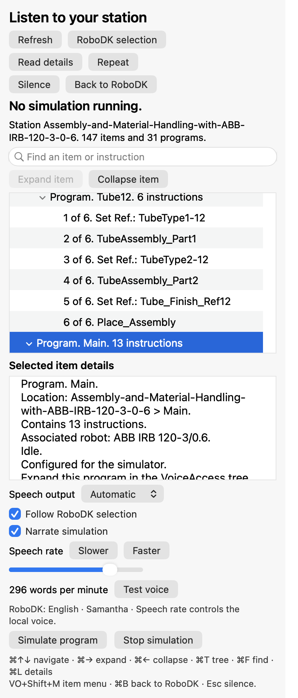

# VoiceAccess for RoboDK

**A screen-reader companion for exploring RoboDK stations and following simulations.**

VoiceAccess adds a keyboard-accessible sidebar that reads station items, program
instructions, and simulation progress. It complements the accessibility already
available in RoboDK, with additional context drawn from the RoboDK API.

**This is an independent, unofficial project. It is not affiliated with, endorsed
by, or supported by RoboDK.**

## Current status

VoiceAccess is an early **macOS / VoiceOver** preview, currently version **0.4.2**.
The sidebar runs inside RoboDK. When VoiceOver is active, VoiceAccess uses native
accessible controls and sends announcements to VoiceOver; its own speech engine
stays silent. With VoiceOver off, an optional local macOS voice provides speech.

| Platform | Screen reader | Status |
| --- | --- | --- |
| macOS | VoiceOver | Available as an early preview. |
| Windows | NVDA | Planned; not implemented yet. |
| Linux | Orca | Planned; not implemented yet. |

The current dock has been tested with RoboDK **6.0.6.26900**, Qt **6.10.1**, and
macOS on **x86_64**. Other RoboDK/Qt combinations and Apple Silicon builds need
separate validation. It does not provide complete screen-reader access to every
part of RoboDK.

## What it does

- **Explore a station:** search and navigate frames, targets, robots, tools,
  objects, folders, and program instructions in an accessible tree.
- **Choose how much to hear:** read the selected item's name, then request its
  full details when needed, including hierarchy, coordinates, visibility, and
  robot/tool context.
- **Follow simulations:** hear the main program's current step and total, with
  movement and completion announcements. Nested calls retain the main program's
  progress counter.
- **Keep speech manageable:** automatic narration finishes the current phrase
  and retains the latest pending update. Fast intermediate steps can be skipped.
- **Work from RoboDK:** open the sidebar from the VA toolbar icon, the VoiceAccess
  menu, an item's context menu, or a keyboard shortcut.
- **Use a resizable sidebar:** dock it on the right, drag its divider to resize it,
  or move its title bar to another dock area. Shorter panels scroll their content.

The panel follows RoboDK's interface language for English, Spanish, and Catalan,
with English as the fallback. VoiceOver keeps its own voice and speech rate.

View the macOS sidebar

## Install and try it

An installable add-in is a `.rdkp` package built from this source. The repository
does not include compiled binaries, RoboDK robot models, or historical packages.
See [Building and development](docs/development.md) to build one locally.

1. Install the resulting `dist/VoiceAccess-0.4.2.rdkp` through RoboDK's Add-in Manager
   and enable VoiceAccess.
2. Open a station and activate **VA** or **VoiceAccess → Open VoiceAccess**.
3. Navigate the sidebar tree with **⌘↑ / ⌘↓**. Use **⌘→ / ⌘←** to expand or collapse
   an item while keeping its selection.
4. Use **Read selection** to hear the selected RoboDK item's name. Choose
   **Read details** inside the panel for the complete description.
5. Enable **Follow RoboDK selection** and **Narrate simulation** as needed.

**Turning VA off has an effect on playback:** disabling it with the toolbar icon,
closing its dock, or choosing **Back to RoboDK** cancels its speech queue, stops
selection following, and stops currently running simulator programs, including
those started from RoboDK. Re-enabling VA restores reading; it does not restart
the simulation. **Silence** is available when you only want to quiet narration.

VoiceAccess playback controls operate in simulation mode. Starting a program from
the sidebar currently requires a station whose programs are configured for the
simulator and which contains no Python programs. VoiceAccess does not connect to
or control a physical robot.

## Keyboard shortcuts

| Action | Shortcut |
| --- | --- |
| Toggle VoiceAccess from RoboDK | ⌘⌥V |
| Read RoboDK selection from RoboDK | ⌘⇧L |
| Focus the sidebar tree | ⌘T |
| Previous / next item | ⌘↑ / ⌘↓ |
| Expand / collapse item | ⌘→ / ⌘← |
| Find an item or instruction | ⌘F |
| Refresh the station | ⌘R |
| Read the selected item's details | ⌘L |
| Read RoboDK selection from the panel | ⌘S |
| Item context menu | VO⇧M |
| Simulate selected program | ⌘Return |
| Stop simulation started from the panel | ⌘. |
| Silence local speech | Escape |
| Disable the panel and return to RoboDK | ⌘B |

Panel shortcuts apply while focus is inside VoiceAccess. **VO** means the
VoiceOver modifier, normally **Control + Option**. Speech-rate controls affect
the optional local voice; adjust VoiceOver's rate in VoiceOver itself.

## Scope and limitations

VoiceAccess supplements RoboDK's existing accessibility. It provides an additional
view of API data; it does not rewrite RoboDK's original menus, toolbar, dialogs,
or station tree. Spatial descriptions of the full 3D scene and voice commands are
not implemented. Simulation narration is based on observed program state and is
not a lossless instruction trace.

Automated checks cover API data, accessibility row structure, keyboard selection,
collapse behavior, dock resizing, speech queuing, and disabling the reader.
Manual testing with VoiceOver remains essential. See the
[accessibility testing guide](docs/accessibility.md) for the checks and how to
report a problem.

The app uses local macOS speech and the local RoboDK API. It needs no microphone,
cloud service, or API key. Settings stay in
`~/Library/Application Support/RoboDKVoiceAccess/`; connection errors are logged
locally in `~/Library/Logs/RoboDKVoiceAccess/`. Detailed standalone navigation
tracing is opt-in through `VOICEACCESS_DIAGNOSTICS=1`.

## Roadmap

- Refine the macOS/VoiceOver experience through screen-reader user feedback.
- Add Windows integration with **NVDA**.
- Add Linux integration with **Orca**.
- Share the station-reading and simulation-narration logic across these platforms.

Windows and Linux are future work; the current native interface uses macOS AppKit.

## Contributing and license

Accessibility reports, reproducible test cases, and contributions are welcome.
Start with [CONTRIBUTING.md](CONTRIBUTING.md), the [development guide](docs/development.md),
and the [architecture overview](docs/architecture.md).

Original VoiceAccess code is available under the [MIT license](LICENSE).
Bundled RoboDK API components retain their own licenses; see
[third-party notices](THIRD_PARTY.md). RoboDK itself and its robot models are
separate software and are not included in this project's license.
