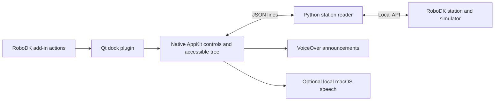

# Architecture

VoiceAccess adds a screen-reader-friendly view of RoboDK data alongside the
application's existing interface. It is not an accessibility patch for RoboDK's
original controls.

`VoiceAccess/` contains Python action entry points and add-in configuration.
`native/dock/` supplies an `IAppRoboDK` Qt plugin. It hosts the native AppKit view
inside a `QDockWidget`, while preserving RoboDK's application delegate and menus.
There is no separate VoiceAccess application window in dock mode.

The AppKit controller requests data from `_voiceaccess/bridge.py`, a worker process
that keeps API work off the UI thread. `_voiceaccess/reader.py` provides semantic
station items, instruction details, selection descriptions, and simulation
progress. Localized output and speech normalization are separate from the raw
station names and visible labels.

VoiceOver always takes priority over the optional speech process. Automatic
narration keeps one pending update so the current phrase can finish without
building a long backlog. Explicit reads have priority.

Disabling the reader cancels pending callbacks and speech, stops polling, and
requests a stop for running simulator programs. Re-enabling refreshes the station
without starting playback. The backend checks both simulator run mode and program
run type before issuing any stop.

A standalone AppKit companion remains as a fallback when the matching native
plugin is unavailable. Its IPC channel accepts only reader UI commands. The
existing `com.robodk.voiceaccess` identifiers are retained for installation and
IPC compatibility; they do not identify an official RoboDK product.

The Python reader is the reusable core for future Windows/NVDA and Linux/Orca
work. Those platform integrations do not exist yet.
